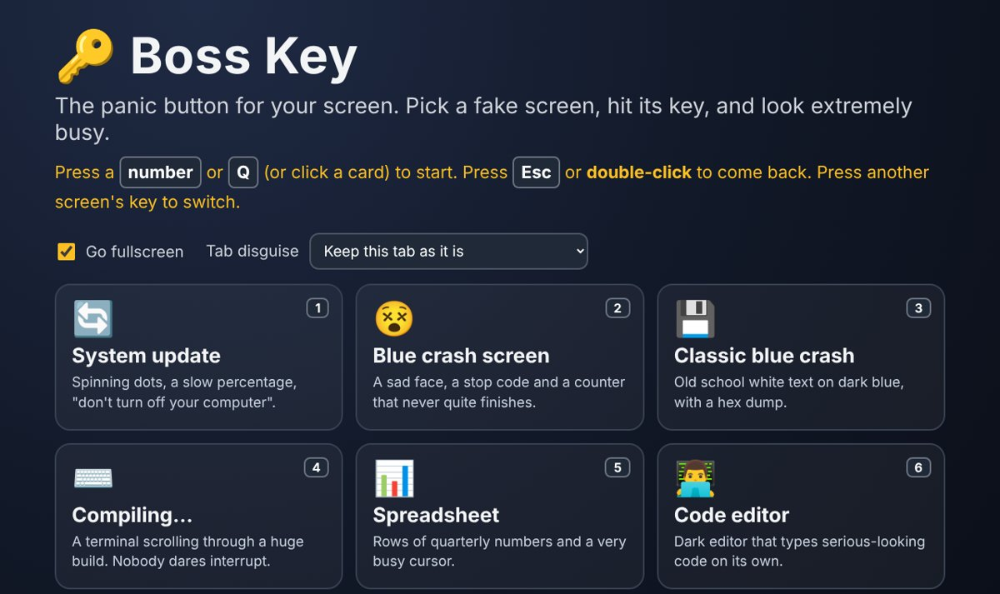
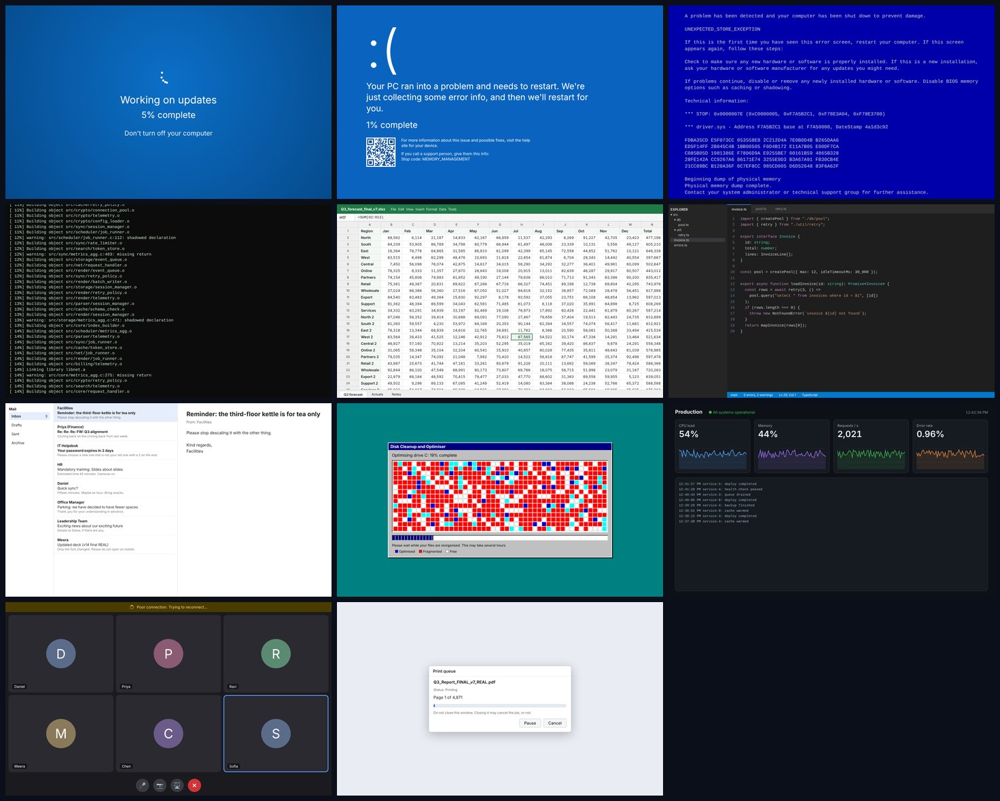

<div align="center">

# 🔑 Boss Key

### The panic button for your screen.
Pick a fake screen. Press its key. Look extremely busy.

[](https://bosskey.vercel.app)


<br>



</div>

---

## ✨ What it is

A single web page with eleven convincing screens that cover your real work in one keystroke. Someone walks past, you press a key, and your monitor now shows a system update, a crash, a very long build, or a spreadsheet nobody wants to question.

Press **`Esc`** (or **double-click**) to come back. Press another screen's key to switch without going back first.

<div align="center">

</div>

## ⌨️ Hotkeys

| Key | Screen | What makes it convincing |
| :-: | --- | --- |
| `1` | 🔄 **System update** | Orbiting dots, a percentage that lurches and stalls, then "Restarting" and starts over |
| `2` | 😵 **Blue crash screen** | Sad face, a stop code, a counter and a QR-style square (it is not a real QR code) |
| `3` | 💾 **Classic blue crash** | White text on dark blue, a hex dump and a blinking cursor |
| `4` | ⌨️ **Compiling…** | A terminal scrolling through an endless build with the odd warning |
| `5` | 📊 **Spreadsheet** | Quarterly numbers that add up, and a cursor that wanders to the next cell |
| `6` | 👨‍💻 **Code editor** | Syntax-coloured code that keeps typing itself out |
| `7` | 📧 **Inbox** | Dull corporate emails, and new ones arrive every so often |
| `8` | 🧩 **Disk cleanup** | Retro blocks shuffling into place with a real progress bar |
| `9` | 📈 **Server dashboard** | Live graphs, a feed of events and "all systems operational" |
| `0` | 📞 **Reconnecting call** | A video meeting that is "trying to reconnect". Again. |
| `Q` | 🖨️ **Stuck print job** | Page 1 of 4,871. Please wait. Please keep waiting. |

## 🎛️ Options

- **Go fullscreen**: hides the browser around the fake screen. Esc leaves fullscreen and the fake screen together.
- **Tab disguise**: while a fake screen is up, the browser tab is renamed to something dull, such as *Untitled document* or *Inbox (3)*, and gets a plain document icon.
- Both settings are remembered on your device. Nothing is sent anywhere.

## 🧠 How it works

Plain HTML, CSS and JavaScript. No build step, no framework, no dependencies.

```
public/
├── index.html     launcher page (includes the Vercel Web Analytics snippet)
├── style.css      launcher styles
├── screens.css    styles for the eleven screens
├── data.js        screen list, seeded randomness, fake logs / emails / code / spreadsheet data
├── screens.js     the eleven screens, each a function that fills the page and cleans up after itself
└── app.js         hotkeys, fullscreen, tab disguise
docs/              screenshots used in this README
test/              unit tests (node:test)
vercel.json        serves /public, no caching so updates show up immediately
```

Small details that make it believable:

- Progress bars **lurch and stall** and slow down near the end, instead of crawling at a steady rate.
- The spreadsheet's totals really are the sum of their rows, and the numbers never change between visits.
- Everything is driven by a seeded random generator, so the data stays consistent while a screen is open.
- All timers are cleaned up when you leave a screen, so nothing keeps running in the background.

## 🛠️ Run it locally

```bash
git clone https://github.com/mskraban/bosskey.git
cd bosskey
python3 -m http.server 8000 --directory public     # then open http://localhost:8000
npm test                                            # runs the data and logic tests
```

Any static file server works. There is nothing to install.

## 📊 Analytics and privacy

The hosted version at **bosskey.vercel.app** uses **[Vercel Web Analytics](https://vercel.com/docs/analytics)** to count anonymous page views.

- The snippet is two lines in [`public/index.html`](public/index.html) and loads from `/_vercel/insights/script.js`. It only works when the site is hosted on Vercel with Web Analytics switched on for the project.
- **No cookies, no accounts, no personal data.** Vercel's script does not use cookies.
- Your settings (fullscreen and tab disguise) are saved only in your own browser.
- If you run the site locally the analytics script simply fails to load, which is harmless.

## ⚖️ Notes

- Made for fun. The screens are **original lookalikes**: generic wording, no logos and no real company or product names.
- Browsers only let a page react to keys while that page is the active tab, so open Boss Key in a tab you can reach quickly.
- Fullscreen needs a user gesture, so it starts when you press a key or click a card, and some phones do not support it at all (the page still covers the whole window).

<div align="center">

---

Built with plain HTML, CSS and JavaScript, tested with `node --test`, hosted on Vercel.

</div>
